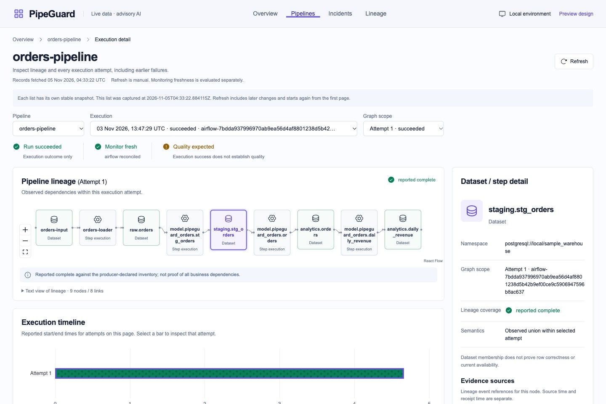
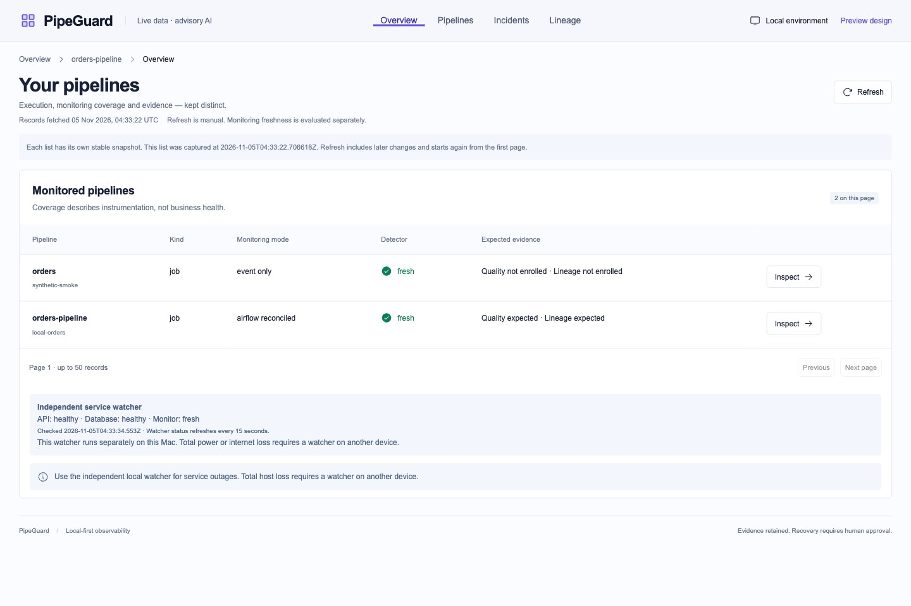
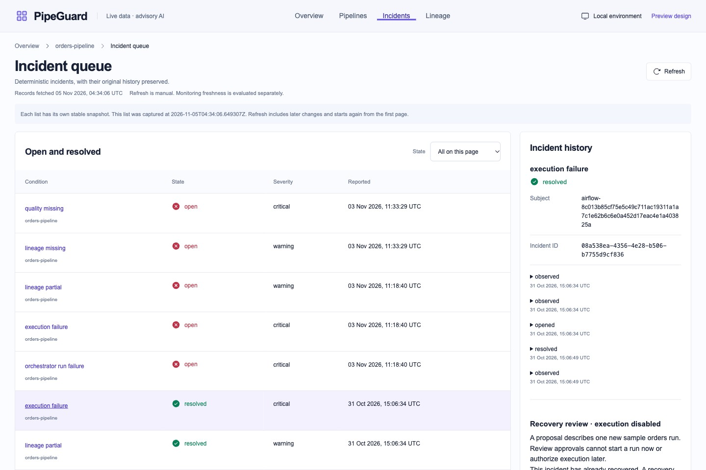
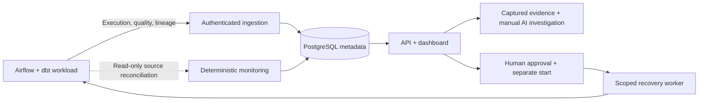

<div align="center">

# PipeGuard

### Understand pipeline failures. Preserve the evidence. Recover with control.

Local-first data pipeline observability with execution history, data quality,
interactive lineage, evidence-grounded AI investigation, and human-approved recovery.

[](docs/container-maintenance.md) [](pyproject.toml) [](apps/pipeguard/web/package.json) [](infra/postgres/README.md)

[Explore the dashboard](#inside-pipeguard) · [Architecture](#how-it-works) · [Get started](#run-locally) · [Documentation](docs/README.md)

</div>



*The running application, using the retained local orders workload. Screenshots were captured on November 5, 2026.*

## Why PipeGuard?

A green pipeline run does not tell the whole story. A retry can succeed after an
earlier failure, quality checks can disagree, and missing observations can leave
operators with an incomplete view of what happened.

PipeGuard connects those facts without erasing their history. It keeps execution
outcome, reported data quality, monitoring coverage, and observed lineage distinct,
so operators can investigate an incident with its original evidence intact.

> **A successful retry resolves the execution failure; it does not delete the failed attempt.**

## Inside PipeGuard

### Know what is being monitored

See monitored pipelines, their observation mode, detector freshness, and expected
quality and lineage evidence. An independent local watcher reports API, database,
and monitor availability separately from business execution health.



### Follow every attempt and dependency

Inspect individual runs and execution attempts alongside their timeline, reported
quality checks, and interactive dataset graph. Select a node to inspect its source
references; use the text view when a graph is dense or keyboard access is preferred.
Historical lineage stays scoped to the selected execution or attempt.

### Investigate incidents with their history intact

Deterministic policies detect execution failures, quality failures and conflicts,
missing evidence, and monitoring gaps. Incidents retain their observations and
state transitions, including earlier failures after a later recovery.



| Capability | What it provides |
| --- | --- |
| **Execution history** | Run and attempt records, retries, late observations, and conflicting terminal evidence. |
| **Data quality** | Versioned results, complete-report inventories, missing checks, and contradictory outcomes. |
| **Lineage exploration** | Bounded OpenLineage ingestion, dataset dependencies, historical traversal, and source references. |
| **Incident evidence** | Captured observations with provenance, timestamps, content hashes, and redaction metadata. |
| **Advisory AI** | Explicit manual investigation through Groq, constrained evidence citations, uncertainty, abstention, and durable request/outcome history. |
| **Controlled recovery** | Exact-proposal approval, expiry, a separate start decision, durable dispatch intent, and exact-run reconciliation. |

AI findings cannot change incident state, approve a proposal, or start recovery.
Recovery execution is normally disabled, and the sample DAG remains paused.

## How it works



The monitored workload and PipeGuard are separate applications. Business records
remain in the sample warehouse; monitoring facts, incidents, evidence, and audit
history belong to PipeGuard. Airflow has its own metadata database and scoped
accounts. The diagram summarizes logical data flow, not one service per box.

[Architecture overview](docs/architecture/overview.md) · [Domain model](docs/architecture/domain-model.md) · [Lineage and evidence](docs/architecture/lineage-evidence.md)

## Technology stack

| Layer | Technologies |
| --- | --- |
| **Application and API** | Python 3.12, FastAPI, Pydantic 2, SQLAlchemy 2, Alembic |
| **Persistence** | PostgreSQL 17 with separate application, Airflow, and sample warehouse databases |
| **Orchestration and transformation** | Apache Airflow 3, dbt Core, OpenLineage |
| **Dashboard** | Next.js 16, React 19, TypeScript 5, Phosphor icons |
| **Graphs and charts** | React Flow, Apache ECharts |
| **Advisory investigation** | Groq-hosted GPT-OSS 120B with local evidence and response validation |
| **Development and verification** | uv, project-local virtual environments, pnpm, Docker Compose, Pytest, Playwright, GitHub Actions |

Python and Node patch versions, dependency locks, the PostgreSQL base digest,
and its minimal Debian security overlay are pinned in the repository.

## Run locally

You will need **Git, Docker Desktop, Python 3.12.16, uv 0.13.7, Node.js 22.23.4,
and pnpm 11.25.0**. The repository is private; cloning requires authorized access.

Prepare a new checkout:

```sh
git clone https://github.com/RJ1899157/PipeGuard.git
cd PipeGuard
uv sync --locked
```

Then follow the [development setup](docs/development/setup.md) to initialize private
configuration, start PostgreSQL, apply migrations, and provision restricted API
credentials. Complete the [Airflow setup](infra/airflow/README.md),
[orders workload setup](sample-pipelines/orders/README.md), and
[dashboard setup](apps/pipeguard/web/README.md) for the complete sample installation.
Each Python component uses its own `.venv`; secrets stay in ignored private files.

<details>
<summary><strong>Already configured? Start and stop the local stack</strong></summary>

Start Docker Desktop. From the repository root, start PostgreSQL:

```sh
docker compose up -d --wait postgres
```

Run each of these in a **separate terminal**, with the repository root as the
working directory and the pinned tools on your PATH:

```sh
# API
uv run --locked --env-file .env python scripts/run_api.py
```

```sh
# Airflow API, scheduler, and DAG processor
uv run --locked --env-file .env.airflow python scripts/run_airflow.py start
```

```sh
# Incident monitor
uv run --locked --env-file .env.monitoring python scripts/run_monitor.py
```

```sh
# Dashboard, after its production build is available
uv run --locked --env-file .env python scripts/run_dashboard.py
```

Open **[PipeGuard](http://127.0.0.1:3000/)**. Airflow is available at
`http://127.0.0.1:8080`; the API is bound to `http://127.0.0.1:8000`.

To stop, finish active workloads/backups, then press **Ctrl+C** in the dashboard,
monitor, Airflow, and API terminals, in that order. Finally:

```sh
docker compose stop postgres
```

This preserves the database volume. Reuse existing private configuration; do not
regenerate credentials or remove volumes for routine startup/shutdown. Apply
reviewed migrations and API grants when upgrading to a revision that needs them.
The independent watcher starts at macOS login and may record intentional downtime.

</details>

The [delivery operations guide](docs/delivery-operations.md) provides the full
startup, shutdown, migration, and isolated-verification procedures.

## Verified behavior

**Checkpoint: November 5, 2026.** All fourteen delivery stages have local acceptance
checkpoints. The latest maintenance verification passed **599 automated cases**:

| Suite | Passing cases |
| --- | ---: |
| Backend | 466 |
| Sample workload | 66 |
| Airflow | 13 |
| Frontend | 54 |
| **Total** | **599** |

Verification also covered a fresh isolated installation, real failure/retry
tracking, HTTP admission limits and deadlines, database outage/restoration,
quality and lineage reporting, production dashboard startup, and cleanup.
Both manual hosted Linux CI jobs passed. All **10,807 captured immutable records**
retained their content hashes across the container patch, and all three database
backups passed restore checks before and after the switch.

[Latest verification](docs/container-maintenance.md) · [Final project audit](docs/stage14-audit.md) · [Passing CI run](https://github.com/RJ1899157/PipeGuard/actions/runs/41967389480) · [Failure coverage](docs/failure-coverage.md)

### Scope and limits

PipeGuard is verified for a local owner installation and controlled sample
workloads. Public multi-user hosting and distributed execution require additional
design. The watcher and backups reside on the same Mac, so total host or disk loss
requires independent infrastructure. AI evaluation covers bounded synthetic cases
and does not establish general root-cause accuracy.

The container's published APT fix is applied. **130 installed-source advisory
matches** remain without published compatible fixes in the recorded scan;
they remain documented risks. See [container security](docs/container-security.md)
and the [current scope limits](docs/next-session.md#explicit-remaining-limits).

## Explore the repository

```text
PipeGuard/
├── apps/pipeguard/          # Monitoring backend, API, tests, and web dashboard
├── infra/
│   ├── airflow/            # Orchestrator configuration and scoped authorization
│   └── postgres/           # Database initialization and pinned security overlay
├── sample-pipelines/       # Independent orders ingestion, dbt, and quality checks
├── scripts/                # Local launchers, provisioning, backups, and verification
├── docs/                   # Architecture, operations, screenshots, and audit evidence
├── .github/workflows/      # Manual delivery checks
├── compose.yaml            # Local PostgreSQL service
├── pyproject.toml          # Application dependencies and tool configuration
└── uv.lock                 # Locked Python dependency resolution
```

| Learn more | Documentation |
| --- | --- |
| **System design** | [Architecture](docs/architecture/overview.md), [domain model](docs/architecture/domain-model.md), [evidence model](docs/architecture/lineage-evidence.md) |
| **Operate PipeGuard** | [Delivery operations](docs/delivery-operations.md), [incidents](docs/incident-operations.md), [local resilience and backups](docs/local-resilience.md) |
| **AI and recovery** | [Investigation](docs/investigation-operations.md), [expanded evaluation](docs/investigation-expanded-evaluation.md), [recovery execution](docs/recovery-execution.md) |
| **Security and acceptance** | [Threat model](docs/security-threat-model.md), [final audit](docs/stage14-audit.md), [latest maintenance](docs/container-maintenance.md) |
| **Project history** | [Delivery roadmap](docs/roadmap.md), [documentation index](docs/README.md) |

---

Built and maintained by **[Rishabh Jain · RJ1899157](https://github.com/RJ1899157)**.
