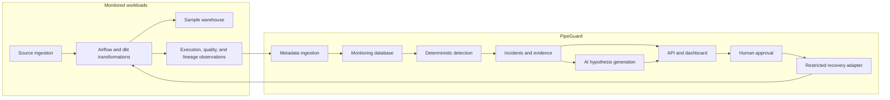

# Architecture overview

**Status:** target architecture with implemented local monitoring, detection, lineage and evidence slices. PostgreSQL configuration, metadata tables, authenticated ingestion/read APIs, migrations and integration checks exist; the independent orders workload is implemented; Airflow orchestration and scoped event reporting are implemented; quality reports, deterministic incident services and independent source reconciliation are implemented; bounded lineage ingestion, historical traversal and evidence snapshots are implemented; a local dashboard with attempt-scoped React Flow lineage is implemented; durable manual advisory investigation is integrated through scoped APIs and the dashboard; the bounded local advisory evaluation gate passes, while broader live-model coverage remains limited. Review-only recovery proposals and human decisions are implemented. The dedicated Airflow recovery account and disabled scoped permissions are [verified](../recovery-airflow-authorization.md); the separate supervised CLI/API/dashboard execution flow passes [bounded local live acceptance](../recovery-live-verification.md), with durable intent and exact-run reconciliation. Both recovery capability switches are disabled again and the DAG is paused.

## Scope

PipeGuard is an observability and incident-management application for independently executed data pipelines. Initial development targets one local installation with synthetic monitored data. Cloud deployment, multi-tenant isolation, and production readiness require subsequent design and validation.

## Logical system

The diagram shows intended data flow, not deployed services. It does not prescribe one process per box; initial application components may share a process while retaining explicit interfaces.

## Responsibilities

| Component                            | Owns                                                                                | Boundary                                                                  |
| ------------------------------------ | ----------------------------------------------------------------------------------- | ------------------------------------------------------------------------- |
| Sample ingestion and transformations | Business records and transformation logic                                           | Emits metadata; independent of PipeGuard internals                        |
| Orchestrator                         | Scheduling, execution, retries, and its own metadata                                | Access through documented APIs/events; no direct reads of internal tables |
| Metadata ingestion                   | Event receipt, validation, deduplication, normalization, and processing state       | Adapters normalize external contracts into application records            |
| Detection                            | Versioned policies, evaluations, incident grouping, and recovery conditions         | Deterministic and auditable                                               |
| Evidence collection                  | Captured observations, source references, timestamps, redaction, and content hashes | Preserve provenance and distinguish unavailable evidence                  |
| Investigator                         | Ranked hypotheses and explicit supporting/contradicting evidence                    | Advisory; may abstain and cannot authorize recovery                       |
| API and dashboard                    | Operational queries, incident views, graph exploration, and approval interfaces     | Must enforce access control at server boundaries                          |
| Recovery adapter                     | Allowlisted commands, approval validation, idempotency, and execution records       | Executes only an authorized, current, unexpired proposal                  |

## Data ownership

The local deployment uses separate PostgreSQL databases and roles for:

- `pipeguard`: application metadata, incidents, evidence references, and audit records.
- `airflow`: orchestrator-managed metadata.
- `sample_warehouse`: raw and transformed business data.

A shared local PostgreSQL instance is acceptable initially. Separate databases and roles improve ownership boundaries but do not provide physical fault isolation. Credentials are supplied through deployment configuration rather than stored inside event payloads.

## Reliability invariants

- Repeated delivery of one event must not repeat its business effects.
- Preserve event time and receipt time, together with source and attempt identity.
- Retain failed attempts after successful retries.
- Keep durable observations available when AI investigation is unavailable.
- Incident state changes require an explicit policy evaluation or audited human action.
- Evidence citations must reference the supplied evidence bundle; citation existence alone does not establish claim correctness.
- Approval binds to an exact recovery proposal revision and expires. Execution validates approval again.

The [domain model](domain-model.md) defines the proposed records and database constraints that support these invariants.

## Deployment direction

Start with local Python and web development environments. Introduce Docker Compose when PostgreSQL and orchestration services are implemented. Keep Python API dependencies separate from Airflow/provider-constrained dependencies when needed.

OpenLineage provides the metadata interchange contract. A dedicated lineage backend such as Marquez and application metrics through Prometheus can be introduced after basic metadata flow is validated. GCP integration is optional and must preserve a useful local workflow.
