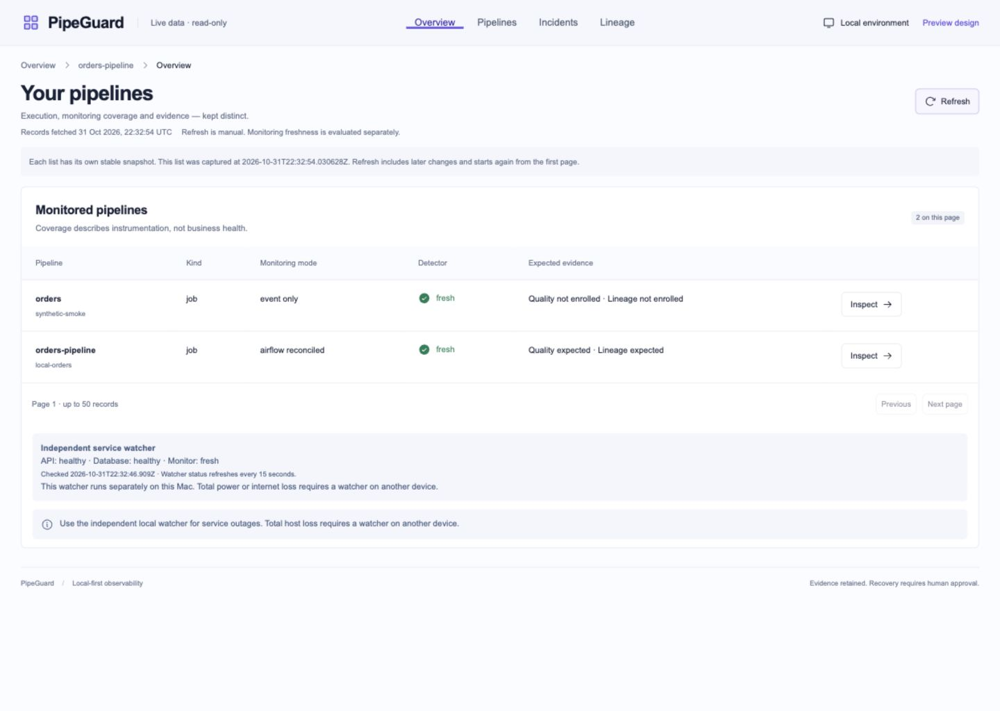

# Pre-investigation hardening verification

Checkpoint date: 2026-11-01. This follow-up completes the hardening interrupted by the usage limit before the grounded-AI investigation stage. It extends the [initial system audit](system-audit.md); it does not claim universal optimality or production readiness.

## Closed gaps

| Previous weakness                                                           | Implemented protection                                                                                                                                     | Verification                                                                                                                                                                                                       |
| --------------------------------------------------------------------------- | ---------------------------------------------------------------------------------------------------------------------------------------------------------- | ------------------------------------------------------------------------------------------------------------------------------------------------------------------------------------------------------------------ |
| API/database/detector outage monitoring depended on the application session | Independent macOS user launch agent, dedicated minimal database role, private bounded journal, stale-sample detection and separately read dashboard status | Real API stop/recovery; clean PostgreSQL stop/restart; API readiness 503 during database outage and 200 afterward; owned watcher SIGKILL followed by launchd restart                                               |
| Restart and backup procedures were incomplete                               | Private consistent logical backups, checksum manifests, data/schema restore verification, marked-interruption inspection and guarded cleanup               | Existing archives for PipeGuard, Airflow and sample warehouse restored and verified in disposable databases; no live replacement; all 18 restored Airflow sequence counters safe; active/unmarked cleanup rejected |
| Workload lock was tied to one checkout                                      | Owner-private, stable per-warehouse lock inherited by dbt; PostgreSQL advisory lock retained                                                               | Different checkout paths and localhost aliases share exclusion; child retains exclusion after parent SIGKILL; unsafe file paths/permissions rejected                                                               |
| Concurrent changes could shift list pages                                   | Principal/filter-bound materialized response snapshots with explicit capture times and expiry/capacity/admission limits                                    | Inserts, retries, incident recovery, acknowledgements, different scopes, stale tokens, capacity and concurrent capture tests; returned data cannot mutate stored snapshots                                         |
| Quality conflicts outside a loaded page were invisible                      | Complete filtered-history SQL conflict summary captured consistently with report rows                                                                      | Backend 55-report case with hidden contradiction; browser 51-report preview, both pages retain conflict notice                                                                                                     |
| Full-history evaluation repeated queries/scans unnecessarily                | Prefetched incidents/run projections, grouped execution/attempt facts, indexed reconciliation facts and seven query indexes                                | Local query/plan benchmarks and invariant regressions; no evidence truncation                                                                                                                                      |
| Broad production inline-script permission                                   | Per-request nonce CSP with dynamic rendering                                                                                                               | Every script nonce matched its document policy on normal and 404 responses; no production unsafe-inline/unsafe-eval script permission; browser hydration checked                                                   |
| Dense graph labels were difficult to inspect                                | Keyboard-usable search/type filters and original-index dependency controls                                                                                 | 200-node cycle search, zero-match/type combination, clear and selection preserve all canvas nodes/evidence                                                                                                         |
| Local navigation could be rejected by strict fetch metadata                 | Narrow app-shell document-navigation exception                                                                                                             | Browser-reproduced 403; positive top-level navigation and negative hostile Host/Origin, iframe, fetch and metadata tests                                                                                           |

## Test and runtime results

- Monitoring/API/migration/operational suite: **253 passed**, with one existing upstream Starlette/HTTPX test-client deprecation warning.
- Independent workload suite: **58 passed**, using disposable schemas for real dbt builds.
- Frontend: **31 passed**, strict TypeScript unused checks, source formatting and production build passed. Total across the three suites: **342 passed**.
- Production HTTP checks: two normal documents and a 404 used unique matching script nonces; all eight JavaScript assets and one CSS asset returned 200; eight hostile read/watchdog requests returned 403. Browser hydration and live navigation passed.
- At 390 pixels, document width and scroll width both measured 390 after fixing the visually hidden table caption overflow. Desktop 1440 and tablet 768 layouts were also inspected.
- All **1,161 baseline evidence/history rows** retained their IDs and native-row hashes across seven tables; zero pending execution receipts. This establishes preservation since the captured baseline, not proof that unseen pre-baseline events were ever received.
- Migration head: `bd47c5a01e29`; Alembic metadata comparison has no pending operations.
- Dependency refresh: OSV returned no known advisories for 177 unique installed Python package/version pairs. Full pnpm dependency audit returned no known vulnerabilities. Results are time-specific. The separate [container package triage](container-security.md) found unresolved upstream OS advisories; these are not included in the Python/pnpm clean results.
- The controlled database outage retained API liveness 200 while readiness correctly returned 503. Readiness and metadata reads returned 200 after PostgreSQL restarted. Airflow was explicitly restarted after its components exited; the DAG remains paused.
- The independent watcher reported API unreachable during the API stop, database unreachable/monitor unknown during the database stop, and healthy/fresh after recovery. No OS notification was submitted.

## Measured optimization

| Disposable-schema measurement              |    Before |    After |
| ------------------------------------------ | --------: | -------: |
| 200-run evaluation SELECT count            |     1,409 |       10 |
| Same evaluation elapsed                    | 827.68 ms | 18.98 ms |
| Latest source receipt among 10,000 records |  2.394 ms | 0.049 ms |
| Latest receipt shared-buffer hits          |       173 |        1 |

Production graph readiness at 1440 × 1024: 200 nodes/1,000 links **433.6, 420.2, 449.2 ms**; 200-node cycle **383.0, 394.3, 388.2 ms**. All six samples were below the 2,000 ms budget. This measures DOM graph readiness, not network startup or frame rate.

The latest-receipt plan changed from sorting to an index-only scan. Measurements are local samples, not throughput guarantees. Evaluation still retains and processes meaningful historical evidence; source polling is eventual and bounded. No historical records were deleted to improve these results.

## Current browser evidence

[Mobile live layout](audit/hardening-mobile.png) · [Mobile quality execution view](audit/hardening-quality-mobile.png). The separate table scroll area remains usable without page-level overflow.

## Operating limits retained deliberately

- The official PostgreSQL 17 image was current at the recorded digest. Debian triage found 116 source-package advisory matches: 62 open with no published trixie fix, 48 unimportant/open, three postponed, one ignored, one undetermined and one not affected. No known fixed-version upgrade candidates existed among these matches. Open library risks remain, and their reachability is not established. See the complete linked triage; recheck as fixes are published.
- The owner has no second always-on device. A powered-off host cannot report its own failure. Off-host alerts and backup copies remain unavailable.
- Warehouse loading and dbt models remain separate transactions. Their failures and uncertainty are monitored; this checkpoint does not redesign the workload as an atomic publication system. Cross-host/direct-SQL writers need separate fencing; the local sample accepts only loopback warehouse connections.
- History grows. The optimized evaluator is not an incremental replay engine; source scan and snapshot capacities are explicit. Exceeding limits produces uncertainty/errors rather than fabricated completeness. Incremental cursors and retention require a reviewed design before larger deployments.
- Restore verification covers selected logical database schemas, not a complete machine/configuration recovery. Unmarked scratch databases are refused rather than deleted by guesswork.
- The UI is a local-owner interface. Strong public authentication, tenant isolation, off-host services and additional business rules are separate product requirements.
- Source claims can be false or disappear between polls. Hashes and append-only evidence preserve what was received; they cannot prove unseen events or business truth.

See [local resilience operations](local-resilience.md) for exact startup, backup, restore-check and snapshot behavior. The next stage must use these explicit evidence and operating boundaries when generating AI explanations.
