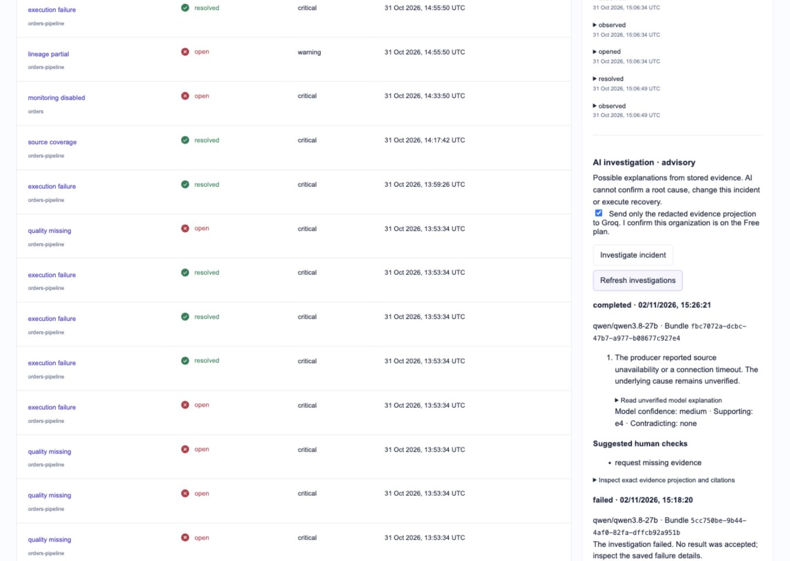

# Investigation integration verification

Checkpoint: 2026-11-02. Scope: the first durable, authorized, dashboard-integrated advisory investigation slice. Stage 10 remains in progress; this report does not establish general model accuracy or production readiness.

## Implemented and checked

| Area                                | Evidence                                                                                                                                                                                                                                                             |
| ----------------------------------- | -------------------------------------------------------------------------------------------------------------------------------------------------------------------------------------------------------------------------------------------------------------------- |
| Persistence                         | Migration `e7c2b936a410`; requests commit before inference; append-only terminal outcomes; immutable update/delete/truncate protections; live metadata comparison clean                                                                                              |
| Authorization                       | Administrator-only generation; producer history restricted to its own integration; unauthenticated reads rejected; cross-incident key/cursor scopes checked                                                                                                          |
| Duplicate and interruption handling | Recorded keys replay without generation; simulated process termination retains an unsettled request; after two minutes its outcome is unknown, not failed; no automatic retry                                                                                        |
| Admission                           | Shared database lock, recent-unsettled-request guard, one-minute cooldown and 20-request rolling-24-hour ceiling; replay remains available during cooldown                                                                                                           |
| Outbound data                       | Bundle hashes checked; truncated/invalid/oversized evidence rejected; identifiers masked; arbitrary source prose excluded; previous failed attempts retained                                                                                                         |
| Grounding                           | Categories and primary citations narrowed to actual packet facts; lineage gaps cannot become execution-failure causes; cross-attempt success cannot contradict an earlier failure; unknown/ambiguous citations rejected                                              |
| Response handling                   | Strict schema plus local checks; explicit abstention; fixed qualified UI summaries; unverified prose collapsed; non-executable enumerated next checks; provider errors and input-free validation diagnostics retained safely                                         |
| Browser boundary                    | Three hostile read requests and three invalid-origin/content-type submissions returned 403; malformed and oversized JSON returned 400; unauthenticated direct API read returned 401; all script nonces matched fresh document policies on two normal pages and a 404 |
| Running system                      | API liveness/readiness 200; runtime OpenAPI matches the committed contract; Airflow metadata/scheduler/processor healthy; `pipeguard_orders` remains paused; no workload was triggered                                                                               |

## Automated results

- **276 backend tests passed**, including 23 investigation checks, migration roundtrip/metadata and the existing monitoring/ingestion/lineage/API regressions. One existing upstream Starlette/HTTPX deprecation warning remains.
- **33 frontend tests passed**, including uncertain-submission-key retention and safe admission-rejection handling.
- Production build, TypeScript and source-format checks passed. No dependency was added.
- Tests of model failures, abrupt termination and admission use isolated schemas and mocked providers; they do not spend Groq quota. Simulated process termination is not a full live-host power-loss test.

## Live provider checks and correction history

Six deliberately initiated dashboard requests used the existing local sample-pipeline incident. Earlier policies exposed unsupported alternative explanations and repeated citation/response-shape problems; one schema variation was rejected by the provider. Four submissions were recorded as failed/rejected, one earlier completed response is retained as unreviewed legacy output, and the final current-policy request completed successfully. None was silently regenerated or removed.

The final finding cites the stored `source_unavailable` receipt for attempt 1. Its default UI wording is qualified: the producer reported source unavailability or a timeout; the underlying cause remains unverified. The successful attempt 2 remains separate recovery context. The finding does not blame partial lineage or classify the later successful retry as contradictory evidence.

The accepted request was replayed through the real API: the request count stayed **six**, with six terminal outcomes. Refreshing the UI preserved the accepted result and prior failures without another provider call. These changing-policy debugging submissions are not a stationary accuracy benchmark; no model-accuracy percentage is inferred from them.

[Mobile investigation view](audit/investigation-mobile.png). At 390 pixels, document and scroll widths both measured 390, including with the evidence inspector expanded; at 768 pixels both measured 768. No browser errors or warnings were captured in the checked session. Generated explanations and technical audit data are collapsed by default. The dashboard's incident metadata and investigation history refresh separately.

## Preservation and deployment checks

All **1,161 baseline evidence/history IDs and native-row hashes** across seven tables remained unchanged. New source observations, evidence bundles and investigation records were added normally. The runtime role has SELECT/INSERT and no UPDATE/DELETE on the investigation tables. Pre-migration and post-migration PipeGuard backups were created and restore-verified, including the new investigation tables, without replacing the live database. Groq credentials remain in the owner-private ignored environment file and are not included in audit records or browser assets.

## Remaining acceptance work

- A broader fixed model-quality evaluation set, repeated trials and explicit quality thresholds across execution, quality, source and lineage incidents. The current evidence gates are deliberately narrow and can abstain on cases outside supported categories.
- Final model selection: the current Qwen model is a preview release. No automatic alternative provider/model is enabled.
- Confidence calibration and evidence enrichment require separate evidence and privacy review. Citation membership and category checks do not prove arbitrary model prose or unseen root causes.
- API/browser guarantees apply to the trusted local-machine deployment. Free-plan status is operator-confirmed; host loss, off-host backup, public multi-user authentication and distributed atomicity retain their documented limits.
- Stage 11 recovery remains planned. No AI response can approve or execute recovery.

See [operating procedures](investigation-operations.md) and the [roadmap](roadmap.md).
