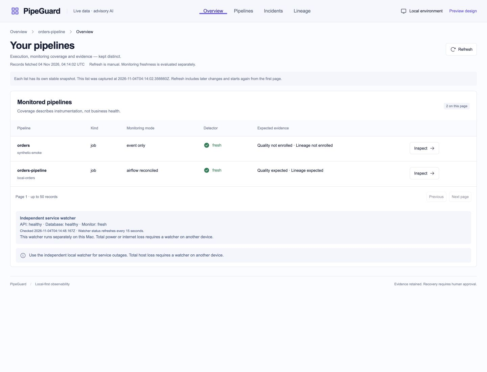
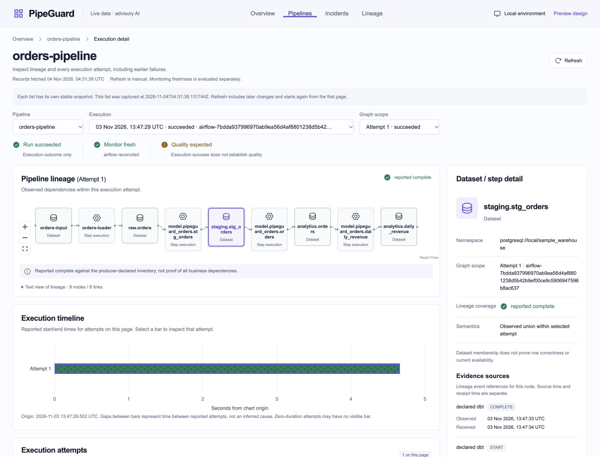
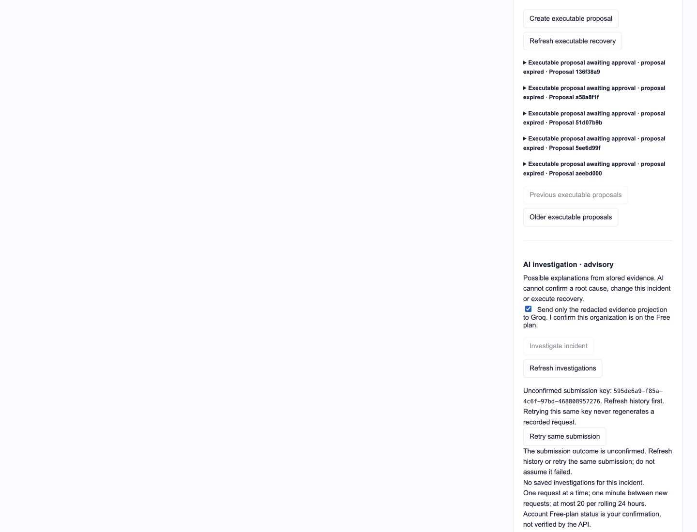
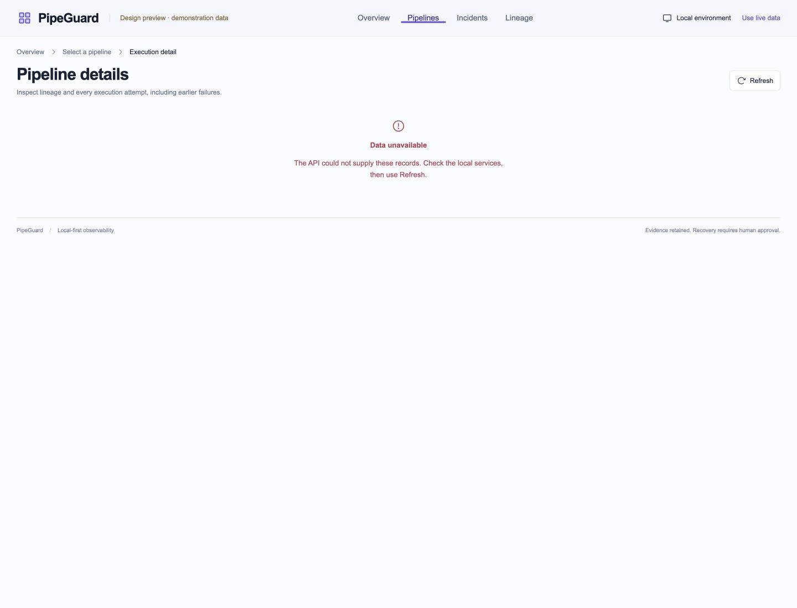
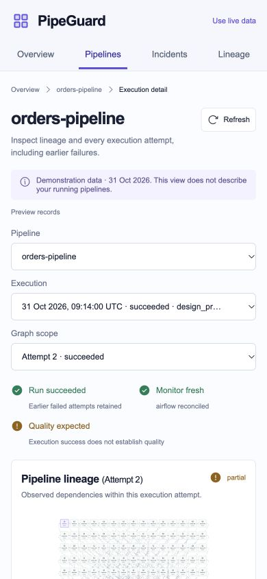

# Post-recovery system audit

Date: **2026-11-04**. Starting revision: `5e1e612`. Three specialist agents reviewed the core backend, recovery/operations/workload, and frontend; the coordinating agent checked the running system, browser flows, contracts, preservation, dependencies and documentation. This audit precedes Stage 12.

## Result and scope

The reproduced application defects below are fixed and the fresh automated checks pass. The bounded local system can proceed to Stage 12 with the explicit residual limits below. This is not a guarantee of perfect behavior, absence of all redundant code, full accessibility compliance, or zero vulnerabilities.

Reviewed scopes cover all owned production API/auth/database/ingestion/detection/source-polling/lineage/evidence/snapshot modules; recovery and investigation modules; launch/configuration/watchdog/backup scripts; Airflow authorization/DAG; independent workload loader/runner/observer/quality/lineage; and frontend components, hooks, routes, graph layout, charts, state, boundaries, configuration and styles. Tests and migration constraints were inspected alongside their affected behavior. Generated contracts were compared with runtime models; lockfiles/installed dependencies received compatibility and advisory checks. Historical reports retain their dated claims. Third-party source trees, every historical shell invocation and every possible distributed failure were not manually audited line by line.

## Defects corrected

| Area                      | Reproduced issue                                                                                           | Correction and regression evidence                                                                                                                                                                        |
| ------------------------- | ---------------------------------------------------------------------------------------------------------- | --------------------------------------------------------------------------------------------------------------------------------------------------------------------------------------------------------- |
| Lineage truthfulness      | Missing indexed dataset edges could still yield `reported_complete`                                        | Compare valid indexed input/output counts with the original declared payload. Missing edges produce partial coverage and `projection_payload_mismatch`; zero/one-of-two edge cases covered                |
| Artifact failure handling | Deeply nested JSON could escape quality/lineage fallback through `RecursionError`                          | Emit explicit incomplete evidence instead of failing an otherwise completed workload; nested artifact cases covered                                                                                       |
| Workload acknowledgement  | An incomplete HTTP response could turn successful business execution into failure                          | Preserve pending durable observations for replay; incomplete and recursive acknowledgement cases covered                                                                                                  |
| Recovery transport        | Incomplete HTTP bodies escaped the uncertain-outcome path                                                  | Retain unknown transport outcome; no repeat business POST                                                                                                                                                 |
| AI request lifecycle      | Same-tick submissions could create distinct keys; aborted responses could clear retained requests          | Synchronous in-flight latch, abort-aware completion and retained-key reconciliation, including unavailable session storage                                                                                |
| Review decisions          | Local expiry was not reflected until refresh, and stale decisions remained actionable during refresh/error | One-next-deadline expiry hook, fail-closed date handling, cleared confirmations and blocked stale decisions; duplicate `expired` text removed                                                             |
| Input admission           | Some read/investigation identifiers accepted trailing newlines                                             | Exact whole-string checks for UUIDs, attempt numbers and snapshot tokens                                                                                                                                  |
| Read transport            | Browser read broker parsed an unbounded upstream JSON body                                                 | Cancel responses exceeding **16 MiB** before parsing; generous margin above the existing 8 MiB captured-content bound plus metadata. Exact-cap, split UTF-8, malformed and oversize stream checks covered |
| Control naming            | Wrapped selector labels did not give reliable exact accessible names                                       | Explicit stable names and associated visible labels for all six selectors and graph search; verified in browser and source regression                                                                     |
| Documentation             | Several architecture/application pages still described investigation/recovery as planned                   | Current boundaries, implemented ledgers, executable worker and documentation index corrected; historical milestones linked rather than rewritten as new evidence                                          |

## Measured optimization

- **Reconciliation:** for 20 attempts of one run, combined run-upsert, lock-read and attempt-list statements fell from **60 to 3**. Locks are retained within the same transaction and reused per distinct run; interleaved-run regression verifies isolation and retained failures. This is a **95% reduction in those measured statement categories**, not a claim of 95% whole-worker acceleration.
- **Recovery supervision:** the parent no longer imports the full application before spawning the supervised child. The 45-second deadline, owned process-group cleanup and credential isolation remain enforced. Twelve warmed live history reads measured median **1,254 ms before / 536 ms after**, maximum 2,281 / 1,114 ms. Timing includes subprocess, DB and API overhead; concurrent machine activity makes this an observational comparison, not a controlled benchmark.
- **Quality extraction:** project shared macro metadata once and hash only the bounded 100 checks actually returned; oversized inventories still report incomplete.
- **Frontend:** share one next-expiry timer implementation instead of duplicating it. No package was added. Strict unused-local/parameter checks pass; a standard-library AST scan found no unused-import candidates across **62 production Python modules**. These checks do not justify deleting retained history, tests, public interfaces or safety guards merely to reduce line count.

Ordinary warmed live read medians remained approximately **3–6 ms** in the sampled small dataset. No project-wide speedup or large-deployment performance guarantee is inferred. Full before/after measurements are in the [verification data](audit/2026-11-04/verification-data.json).

## Fresh verification

| Check                            | Result                                                                                                                                                           |
| -------------------------------- | ---------------------------------------------------------------------------------------------------------------------------------------------------------------- |
| Combined backend suite           | **425 passed**, one existing upstream Starlette/HTTPX deprecation warning                                                                                        |
| Frontend suite                   | **46 passed**                                                                                                                                                    |
| Independent workload suite       | **64 passed** in isolated schemas                                                                                                                                |
| Pinned Airflow interpreter       | **13 DAG/authorization checks passed**                                                                                                                           |
| Total distinct suite cases       | **548 passed** across these four suites                                                                                                                          |
| Static/build checks              | Strict TypeScript unused checks, frontend formatting and production build passed                                                                                 |
| Contracts                        | All three committed event/report JSON Schemas and OpenAPI match current runtime models                                                                           |
| Preservation                     | All **6,490** captured immutable row IDs and database-native hashes retained; mutable receipt-processing fields excluded; later monitoring receipts may be added |
| Existing source                  | **8 native runs / 14 attempt snapshots**; DAG remains paused, recovery switches off; no new business run or real Groq generation                                 |
| Existing ledger/provider records | Still **1 action / 1 approval / 1 dispatch / 2 observations**, **16 investigation requests / 16 outcomes**                                                       |
| Disposable UI dataset            | Removed after verification; live API restored; no test schemas remain                                                                                            |
| Services/network                 | API readiness/dashboard healthy; PostgreSQL, API, dashboard and Airflow bind to loopback; independent local watcher fresh                                        |
| Backups                          | Fresh backups of all three databases restored in disposable databases; schema/row checks passed; no live database replaced                                       |

The frontend build was performed with the owned production server stopped, then the server was restarted. Disposable faults used a fake provider and fake source with external calls explicitly forbidden. No recovery capability was enabled and no DAG was unpaused during this audit.

## Browser walkthrough

These screenshots were captured during this audit. The uncertainty screenshot is explicitly synthetic; its apparent Groq consent never contacted Groq. Tests and runtime checks complement screenshots; screenshots alone cannot establish accessibility compliance or all failure behavior.

1. **Overview and watcher — healthy.** Refresh, pipeline inspection, explicit monitoring modes and independent service status work. [Screenshot 1](audit/2026-11-04/01-overview.jpg).
2. **Execution, lineage, quality and evidence — healthy.** Named pipeline/run/attempt selectors work; earlier failed attempts remain selectable. Graph zoom/fit, text search/type filter, dataset selection, evidence open/close and report inspection work. Separate execution success, quality and source completeness remain explicit. [Screenshot 2](audit/2026-11-04/02-execution.jpg).
3. **Review and executable controls — healthy in isolated verification.** A fresh 15-second proposal expired without refresh; refresh reset confirmation and blocked old decisions. Approval and start were separate; one fake dispatch progressed unknown → succeeded. Both cursor directions and expired-intent replay worked, retaining one intent and one fake start.
4. **Uncertain advisory submission — healthy in isolated verification.** An injected 503 followed a committed fake outcome. The exact request remained visible. Navigation reconciled the one recorded result; final counts were one request/outcome/fake generation, with no regeneration. [Screenshot 3](audit/2026-11-04/03-uncertain-submission.jpg).
5. **Error and boundary states — healthy.** Empty, stale, unavailable and unauthorized previews were checked. The exact fifty-history boundary opens an empty second preview page and can return to page one; no claim is made that a simulated boundary is live data. State filtering works. [Screenshot 4](audit/2026-11-04/04-unavailable-preview.jpg).
6. **Mobile/tablet and dense graph — checked.** At 390 × 844 and 768 × 1024, document width matched viewport width. The 200-node cycle fixture remained partial and rendered without horizontal document overflow; dense labels require the provided text search/filter alternative. [Screenshot 5](audit/2026-11-04/05-mobile.jpg).

## Dependency and container findings

All three Python environments pass dependency compatibility checks. Current OSV queries found **zero known matches** across the installed root **28**, Airflow **131** and workload **65** packages. Frontend package audit reports zero matches across its 86 recorded dependency entries. These are point-in-time advisory checks, not proof of vulnerability absence.

The container requires a different conclusion. Current OSV results match **130 advisories** across the existing 95 installed source/version pairs, **14 more** than the old checkpoint: three GCC and eleven SQLite records. Debian trixie has **127 open, 2 undetermined, 1 resolved** release records among these matches. None has a published nonzero trixie fixed version in the matched records. Thirteen new records carry Debian's “Minor issue” no-DSA rationale; one new SQLite record is undetermined. Such labels neither prove exploitability through PostgreSQL nor establish safety.

The official `postgres:17` multi-platform index changed to `sha256:3b0cda93be7c8dba2ed484d19393d93845dc3dafb88973e248ba8e6d99d784e1`, but its Linux ARM64 image remains exactly `sha256:ac359420747e1f5f8ac4d23f40d7ce022c0a39090ed6cdd8dde5f596affbe41d`, the same as the pinned image on this Mac. Updating only the index would not change these installed bits. No container/package/database upgrade was performed. The [per-record evidence](audit/2026-11-04/verification-data.json) and [earlier triage rationale](container-security.md) retain the unresolved risk.

Primary sources: [OSV query API](https://google.github.io/osv.dev/post-v1-querybatch/), [Debian release tracker](https://security-tracker.debian.org/tracker/data/json), [official PostgreSQL image metadata](https://github.com/docker-library/official-images/blob/master/library/postgres). Public advisory queries received package versions only, not application evidence or credentials.

## Work remaining

1. **Stage 12 — integrated operations and delivery.** Add CI for the independent environments and frontend, define reproducible isolated checks, exercise a clean checkout/start/stop procedure, and assemble operating procedures/evidence. No CI workflow currently exists. Optional application metrics should be introduced only with a concrete operating need.
2. **Stage 13 — final security, measured performance and debugging acceptance.** Revalidate the delivered system after Stage 12 changes: threat model and permissions, input/injection/secret boundaries, dependency risks, recovery authority, larger representative histories/graphs, query/process performance, interruption/outage/restore scenarios, and closure of the final regression report. This audit supplies evidence but does not mark that later delivery gate complete.
3. **Stage 14 — final full-project multi-agent audit.** Added after this audit at the user's request: independently review the final revision after Stage 13, covering owned source, every feature/button/view, commands, dependencies and documentation. Fix and retest reproduced defects, substantiate optimization with measurements and document remaining risks before final delivery sign-off. See the [roadmap](roadmap.md#how-the-final-reviews-differ) for the distinction between the two final gates.
4. **Explicit deployment limits.** Same-host watcher/backups do not cover total host or disk loss; an independent watcher/backup destination is still absent. Public multi-user deployment, distributed fencing/retention and atomic workload publication need separate design if those scopes are chosen. Broader live AI incident-class accuracy remains unestablished. Container advisories need upstream fixes or a separately reviewed compatible image design.
