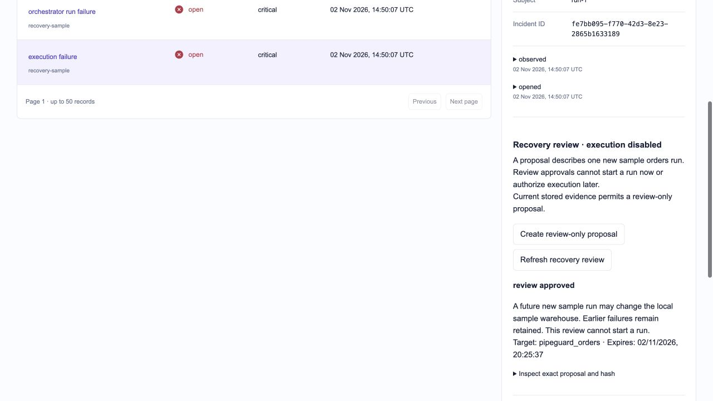

# Recovery review verification

Checkpoint: 2026-11-02. Stage 11's **proposal and human-review milestone** is complete. Stage 11 as a whole remains in progress: no executable recovery policy, dispatcher or external-outcome reconciliation is implemented.

## Delivered

- Append-only proposals and approve/reject decisions, exact hashes, fixed sample-DAG action, deterministic prospective run ID and five-minute expiry.
- Administrator-only mutations, integration-scoped history, bounded inputs, incident-scoped keyset pagination and replay-safe request keys.
- Deterministic checks for current failure, settled attempts, enabled integration, exact target binding, fresh monitoring/source coverage, unpaused source, independent failed-run evidence and unchanged semantic evidence.
- Dashboard controls with explicit review confirmation, impact and expiry, retained history, accessible native controls and an inspector for the exact proposal/hash.
- No external action: every proposal is `review_only`, every response has `can_execute: false`, and an execute route returns 404. These approvals cannot satisfy a future execution-policy approval requirement.

## Checks and evidence

| Area                           | Result                                                                                                                                                                                           |
| ------------------------------ | ------------------------------------------------------------------------------------------------------------------------------------------------------------------------------------------------ |
| Backend regression suite       | **339 passed**, including 27 recovery checks; one existing upstream Starlette/HTTPX deprecation warning                                                                                          |
| Frontend policy/boundary suite | **36 passed**, including three recovery checks for fixed operations, scoped read paths and uncertain-submission retention                                                                        |
| Build and static checks        | Production build, TypeScript with unused-symbol checks, formatting and whitespace checks passed; no dependency added                                                                             |
| Database                       | Migration `f102b8e6d391` applied; Alembic reports no schema drift; disposable migration roundtrip passes                                                                                         |
| Runtime permissions            | Recovery tables allow SELECT/INSERT and deny UPDATE/DELETE; owner-level UPDATE/DELETE/TRUNCATE attempts rejected by immutable-history triggers                                                   |
| Browser/API boundaries         | **11 negative HTTP checks passed**: hostile hosts/origins, cross-site/content-type violations, malformed/oversized/unsupported bodies, newline identifiers and unauthenticated direct API access |
| API contract                   | Running OpenAPI matches the committed JSON contract                                                                                                                                              |
| Interruption/replay            | Proposal and decision mutations roll back in simulated pre-commit process stops; replay after commit/expiry returns the recorded review without renewing authority                               |
| Preservation                   | All **1,161** baseline evidence/history IDs and native-row hashes unchanged; mutable receipt processing metadata excluded as in the original baseline                                            |

## Browser verification with isolated data

The normal production dashboard build was temporarily connected to an API using a **disposable PostgreSQL test schema**. The fixture job was `recovery-sample`, with synthetic independent-source facts and fresh fixture heartbeats. Groq generation was disabled and its key removed from the fixture process. No Airflow calls, workload runs, live source edits or live incident approvals were performed.

The browser checks covered:

1. Create a review-only proposal; approval and rejection start disabled until the exact-proposal confirmation is checked.
2. Approve its review and refresh; the saved decision remains visible.
3. Create another proposal and reject it; both decisions remain visible in history.
4. Expand the exact proposal/hash inspector.
5. Exercise native keyboard confirmation using Space and approval using Enter.
6. At **390 pixels**, document and scroll widths both equal 390, including with the inspector expanded. At **768 pixels**, both equal 768. Desktop layout was inspected at the browser's normal 1,280-pixel viewport. Temporary viewport overrides were reset.

[Mobile approval and rejection history](audit/recovery-mobile.png). These screenshots show isolated verification records, not operational approvals in the live database.

### Lost-response check

A one-shot fixture fault returned HTTP 503 **after** a proposal committed. The dashboard displayed an unconfirmed saved request and disabled new submissions. Selecting **Retry saved review request** replayed the same key and recovered the existing proposal. The fixture proposal count stayed **one before and after replay**; its pipeline-run count stayed one. Subsequent keyboard approval created one decision. The fixture still had zero investigations and no new workload run.

The fixture uses separate disposable schemas; they were removed after verification, including checking cleanup after the test server stopped. This is a controlled lost-response and pre-commit interruption check, not a full live-host power-loss simulation. Load-older pagination is covered through the scoped API tests; a browser history of more than 20 recovery proposals was not generated.

## Restored live system

- The normal API and dashboard were restored; API liveness, authenticated readiness and dashboard returned HTTP 200.
- The live database contains **zero** recovery proposals/decisions. Its existing **16** investigation requests and **16** outcomes remain unchanged in count; this milestone made no new Groq generations.
- No disposable test schemas remain. The current sample DAG remains paused. The dashboard correctly blocks review of its already resolved execution incident.
- Pre-migration and post-migration PipeGuard backups were created and restore-verified in disposable databases; no live database was replaced.
- Groq and API credentials were absent from browser JavaScript assets; the root environment file remains mode 0600. No project `AGENTS.md` or personal learning material was added.

## Airflow authorization follow-up

The [scoped Airflow authorization checkpoint](recovery-airflow-authorization.md) adds a dedicated recovery account, disabled run-creation capability, startup guards and private account pre-seeding. Nine isolated permission tests, twelve live HTTP checks and all 340 backend tests passed. Existing six Airflow runs and eleven attempt snapshots remain present; the DAG stays paused. No frontend, database schema or external action changed in this follow-up.

## Remaining Stage 11 acceptance work

Verify successful Airflow mutation/conflict semantics in a deliberate scenario; implement a distinct executable proposal/approval policy, durable dispatch intent, deterministic external identity, stale-state revalidation and independent outcome reconciliation. Then verify duplicate dispatch, lost replies, process/host interruption, dependency outages and a deliberately approved synthetic end-to-end recovery. The existing review-only approvals must remain non-executable.

The current checks are bounded, point-in-time review controls. They do not establish exactly-once external execution, public multi-user security or recovery safety. See the [operating guide](recovery-operations.md) and [design](recovery-design.md).
