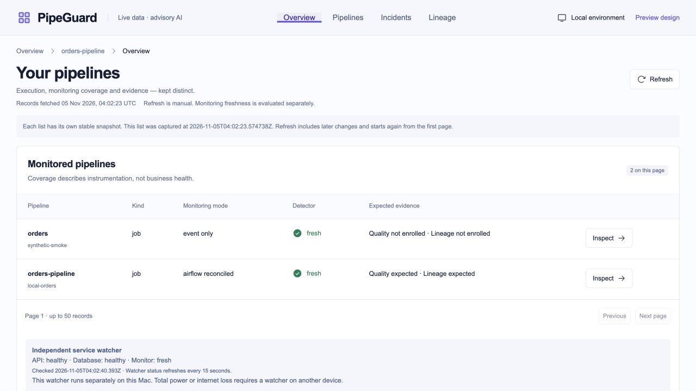
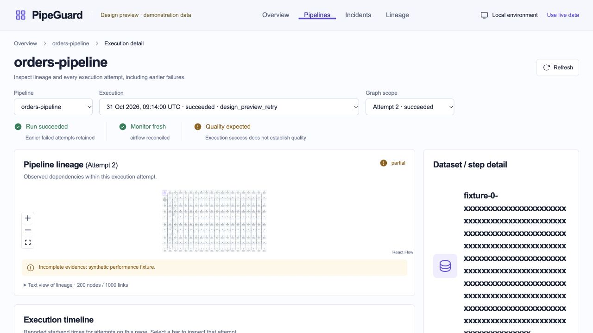
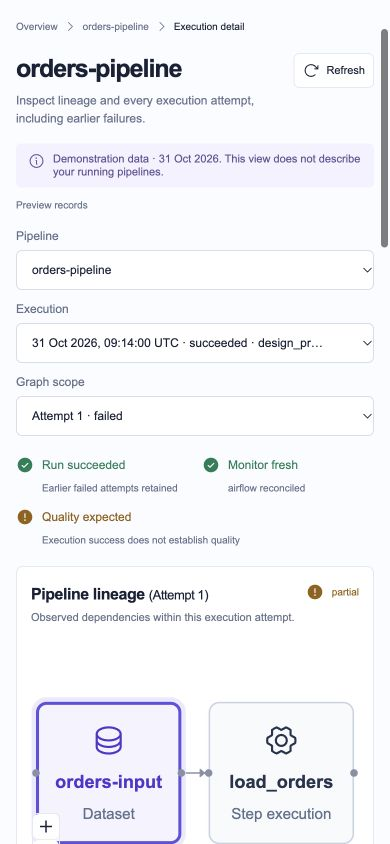

# Stage 14 final project audit

Started 2026-11-04; resumed 2026-11-05 after an interrupted session.
Status: **bounded local audit passed on 2026-11-05**.
Tested revision: `5f10728e70a4200167337d63195dea1ecc4c1e91`.
[Structured results](audit/stage14-verification.json).
Baseline: `ce4361c4c6a1b4f14237af6f5703ccc2fe6e69a7`.

## Scope and method

Three independent reviewers covered backend/persistence/contracts, dashboard and
operational/workload/recovery code. The coordinator reviewed their changes,
checked the running browser, measured graph geometry and coordinated fresh-export
acceptance, restores, immutable-row checks, dependency checks and Git attribution.
Generated contracts and lockfiles receive structural/provenance/runtime-equality
checks; this is not a manual audit of third-party dependency implementations.

## Confirmed fixes

| Finding | Correction | Verification |
| --- | --- | --- |
| Ambiguous colon-prefix evidence scope and run named `job` | Derive scope from incident condition and match exact run identity; preserve historical bundles | Seven unique-schema regressions; independent cross-review of every detector condition |
| Backward/frozen wall clock could extend cached freshness | Require valid, nonnegative wall and monotonic ages, both at most 90 seconds | Three deterministic regressions; no OS-clock change claimed |
| Long valid graph names overlap adjacent nodes | Bound visual labels to three lines, retaining full accessible/detail names | Before: 200-node fixture has four overlap pairs, maximum height 383 px; after: zero overlaps and maximum height 121 px |
| Low small-text contrast | Darker footer and attribution text | Token contrast regression; rendered colour is rgb(102,114,140), matching the tested contrast token |
| UTC conversion overflow misclassified malformed source data | Catch overflow as `InvalidSource` | Upper/lower timestamp-boundary regressions |
| Connectivity diagnostic generated outside normal incident admission | Fixed authenticated model-metadata GET only; remove direct generation path | 18 mocked CLI/allowlist cases; no live provider request |
| Current operating docs described already implemented features as pending | Update runtime, recovery namespaces and current-versus-historical verification wording | Documentation and link checks |

The baseline fresh-export run passed 566 cases plus HTTP/contract/build checks;
that result predates these fixes. Final fresh-export acceptance on the tested
revision passed **599 cases** (466 backend, 66 workload, 54 frontend, 13 Airflow),
contracts, migrations, three dependency environments, TypeScript, formatting,
production build, HTTP startup, body deadlines and database-access outage/restore.
Cleanup passed. Both jobs in [hosted run 41965505014](https://github.com/RJ1899157/PipeGuard/actions/runs/41965505014)
also passed on that same source revision; automatic triggers remain disabled. Three fresh database backups passed disposable restores before the
interruption. No hosted AI generation, recovery action or retained business run
is authorized as an audit shortcut.

## Boundaries retained

Recovery stays disabled and the sample DAG stays paused. The immutable baseline
contains 8,226 rows across 15 tables; later background observations may append.
Independent off-device monitoring/backups are declined for this local project.
The old stuck GitHub run is deferred. Container advisory and broader deployment,
AI-accuracy and atomic-publication limits remain explicit; this audit cannot
establish universal optimality, zero vulnerabilities or exhaustive permutations.

## Preservation and audit outcomes

All **8,226** captured immutable rows retain IDs and native-row content hashes.
The public investigation ledger remains 16 requests/16 outcomes; all 16 additional
isolated evaluation records replayed unchanged with zero new provider calls.
Source inventory remains **8 runs/14 attempts**. Recovery flags are both off and
the DAG remains paused. API live/ready/dashboard return 200, OpenAPI matches the
stored contract, and project listeners remain on loopback. Three fresh backups
passed disposable restores; no restore-check database or delivery container remains.
The existing upstream Starlette/HTTPX deprecation warning is retained.

Python OSV queries returned zero matches across 28 application, 65 workload and 131
Airflow package entries. Frontend audit returned zero known advisories across 86
entries. These are time-specific advisory lookups, not proofs of vulnerability absence.

### Container maintenance finding at audit sign-off

Subsequent [verified image maintenance](container-maintenance.md) closed the APT
fix described below. This section retains the original audit checkpoint.

The 2026-11-05 refresh returns **131 installed-source matches**, up from 130.
Debian now publishes **APT 3.0.4** for [CVE-2026-109518](https://security-tracker.debian.org/tracker/CVE-2026-109518);
installed APT is 3.0.3. The official PostgreSQL 17 ARM64 image remains unchanged.
There is **one published compatible package fix**, pending a reviewed derived-image
maintenance change or an updated official image. The image was not silently modified.
Other matched records have no published nonzero compatible fixed version in this
snapshot; the existing bulk-feed discrepancy remains explicit. This is an open
vendor/image-maintenance risk accepted separately from the owned-code gate.

## Browser flow checks

1. **Live execution/lineage:** pipeline/run/attempt selection, scoped graph and
   quality display checked; execution success remains distinct from quality.
2. **Overview:** both monitoring modes and independently fresh watcher displayed.
3. **Incidents:** resolved filtering, selected history, retained old investigations
   and disabled recovery controls checked. No new investigation/proposal/start sent.
4. **Expired snapshots:** refusal appeared naturally; Refresh obtained fresh records.
5. **Graph alternatives:** text search narrowed nine nodes to one and preserved
   touching links; dense 200-node fixture retains full names with bounded labels.
6. **Quality pagination:** the 51st conflicting report remained represented in the
   global conflict summary, and Next reports selected page 2 with all outcome classes.
7. **Mobile/keyboard:** 390px layout has390px document width; skip link focuses MAIN;
   earlier failed attempt remains selectable beside the successful overall run.
8. **Preview error states:** empty, access-denied and unavailable views remain clearly
   labelled demonstrations. These do not claim actual authentication/network outages.
9. **Final live overview:** API/database healthy and monitor fresh; inspected browser
   logs contained no errors/warnings. Temporary viewport override reset.

These are representative current browser checks plus the isolated control-path
suites. Mutating recovery and provider controls were not executed against retained
business data. No screen-reader certification, universal WCAG compliance, every
browser/permutation or production-scale throughput claim is made. One graph-render
sample per version is diagnostic only; the geometry improvement is the measured fix.

Historical audit images with JPEG bytes were renamed to `.jpg` without changing
content; internal references were updated. Historical captures remain historical,
and the new screenshots above were captured during this audit. Per-file review
methods and hashes are recorded in [the inventory](audit/file-inventory.csv).

## Sign-off scope

The fourteen roadmap stages now have local acceptance checkpoints. No confirmed
owned-code finding from this review remains open. Container/image maintenance,
local-owner trust, same-host monitoring/backups, larger deployments, broader AI
accuracy and non-atomic warehouse publication remain explicit limits. The owner
has deferred the old GitHub run cleanup and declined off-device services. These
are not represented as completed security guarantees.
