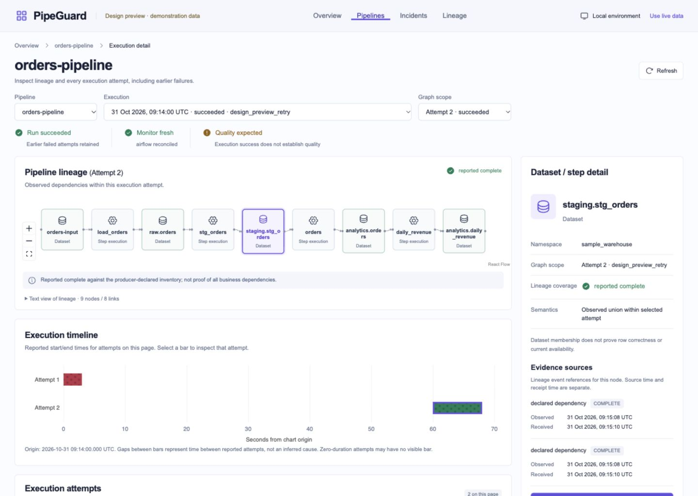

# System audit and interruption recovery

**Follow-up:** [2026-11-01 hardening verification](hardening-verification.md) closes the actionable pagination, conflict-summary, service-watcher, backup, concurrency and browser-script gaps from this initial audit. Counts below describe the original checkpoint.

Date: 2026-10-31. Scope: all implemented PipeGuard features through the initial Stage 9 exploration checkpoint. Three specialist reviewers covered monitoring/persistence/contracts, the frontend, and workload/infrastructure/operations; the integrating reviewer checked fixes, runtime behavior, browser flows and evidence preservation.

## Outcome

The interrupted work was present in the checkout and has been completed. API, monitor, dashboard and Airflow restarted successfully against the existing PostgreSQL database. No schema change or deletion of live evidence was required. The existing successful retry still exposes attempt 1 `failed/source_unavailable` and attempt 2 `succeeded`; its quality report contains 14 passing checks. The DAG remains intentionally paused.

At audit start, a private baseline captured 898 rows across seven evidence/history tables. After fixes and runtime restarts, every baseline ID remained present and every row hash matched. The baseline included 31 execution receipts, 754 observations, 18 lineage events, 10 lineage runs, 32 dataset mentions, one evidence bundle and 52 incident history records. Mutable execution processing fields were excluded from receipt hashes. New monitor observations are permitted. The final check found zero pending execution receipts; the brief Airflow restart coverage episode was recorded and resolved, retaining its history. This establishes preservation during this audit; without a pre-interruption snapshot it cannot prove that no never-received event was lost before the audit began.

## Findings and corrections

| Priority | Finding                                                                                  | Correction and verification                                                                                                                     |
| -------- | ---------------------------------------------------------------------------------------- | ----------------------------------------------------------------------------------------------------------------------------------------------- |
| P1       | Returning pause/resume states deduplicated against old evidence, leaving stale incidents | Immutable source-state episodes, serialized per job; repeated pause/resume regressions                                                          |
| P1       | Failed → succeeded → failed DAG state could remain resolved                              | Preserve returning DAG state episodes, including partial scans and repeated old source timestamps                                               |
| P1       | A quality report could borrow execution evidence from another attempt                    | Require matching attempt evidence; missing exact attempt remains unknown until explicit recovery evidence                                       |
| P1       | Parent SIGKILL could release exclusion while dbt survived                                | Persistent local flock descriptor inherited by dbt, alongside the PostgreSQL lock; synthetic SIGKILL regression and actual dbt descriptor check |
| P2       | Catchable termination/timeouts could orphan descendants                                  | Owned process groups, bounded waits and escalation; SIGINT/SIGTERM/timeout regressions; dashboard launcher replaces itself with Next            |
| P2       | Interrupted private configuration writes could block retries or leave partial files      | Shared atomic mode-0600 publication, unique temporary files, exclusive initial creation and synchronization; failure/retry/symlink regressions  |
| P2       | Invalid outbox records/acknowledgements could block healthy replay                       | Bounded 64 KiB reads, malformed-shape handling; bad records remain pending while healthy records replay                                         |
| P2       | Poll receipts caused increasing evaluation allocations                                   | Hydrate only latest scan receipt, preserve all stored evidence; filter execution receipts by job in SQL                                         |
| P2       | Some validated strings exceeded database column limits                                   | Match 100-character boundaries; reject 101 with 422, accept 100; regenerate and compare OpenAPI                                                 |
| P2       | Incident Previous control disappeared on empty boundary page                             | Pager outside empty-content wrapper; exact-50 fixture verifies return                                                                           |
| P2       | Numeric selected-edge position could silently point to another dependency                | Stable scoped source/target selection; reorder/insertion regression                                                                             |
| P2       | Cycles became extremely tall; fit view clipped the graph                                 | Strongly connected component layout and wider zoom range; all fixture nodes/links retained                                                      |
| P2       | Escape could reselect a graph node                                                       | Stop propagation before clearing; real keyboard check with focused node/dependency                                                              |
| P2       | ARIA decals made invisible timeline offsets visible as bars                              | Explicit invisible spacer style; regression and screenshot confirm blank waiting gaps                                                           |
| P2       | Airflow release constraints included affected dependencies                               | Reviewed compatible security constraints, regenerated hash lock, isolated environment sync; see Airflow advisory table                          |
| P3       | Inactive UI views requested unrelated data                                               | Gate execution/incident/source reads to active views                                                                                            |
| P3       | Provisioning checked only first policy page                                              | Bounded pagination and matching-second-page regression                                                                                          |
| P3       | Breadcrumb destination and documentation contradicted current behavior                   | Correct label and implemented/planned status descriptions                                                                                       |
| P3       | Redundant CSS rules and unused imports                                                   | Consolidated effective graph styles; removed confirmed unused imports; strict frontend unused checks                                            |

## Verification results

| Area                       | Result                                                                                                                                                                                        |
| -------------------------- | --------------------------------------------------------------------------------------------------------------------------------------------------------------------------------------------- |
| Monitoring/API/persistence | 205 tests passed against unique disposable PostgreSQL schemas; one upstream Starlette/HTTPX deprecation warning                                                                               |
| Sample pipeline/dbt        | 55 tests passed, including real isolated-schema builds, fault/recovery, replay, concurrency and subprocess interruption                                                                       |
| Frontend                   | 21 tests, strict TypeScript unused checks, formatting and production build passed                                                                                                             |
| Migrations                 | Alembic metadata check: no new operations; suite includes migration round trip and protected downgrade                                                                                        |
| Runtime API                | Liveness/readiness 200; unauthenticated jobs 401; browser Origin rejected 403; scoped stored retry and quality reads succeed                                                                  |
| Dashboard broker           | Allowed read 200; hostile Host/Origin/Fetch Metadata 403; POST 405; unknown read kind 400                                                                                                     |
| Secrets                    | Configured secrets from all four private environment files and Airflow users absent from 164 repository files and 14 emitted browser assets; private configuration remains ignored            |
| Airflow                    | Patched 3.3.2 CLI works; DAG import errors empty; viewer scan complete with 11 attempt snapshots and six run facts; DAG remains paused                                                        |
| Dependencies               | All three Python environments compatible; OSV queried 177 unique installed version pairs, zero known advisories after updates; pnpm full dependency audit returned zero known vulnerabilities |
| Infrastructure/commands    | Compose configuration, shell syntax, Python parsing, relative documentation links, whitespace and reproducible Airflow lock checked                                                           |
| Browser                    | Four views, selectors, report/history navigation, chart click, graph zoom/fit, keyboard selection/clear, evidence source open/close, Refresh and explicit uncertainty states checked          |
| Responsive                 | 1440, 768 and 390 pixel layouts inspected; no page overflow at tested widths; mobile evidence reachable                                                                                       |
| Graph readiness            | 200-node branching and cyclic fixtures each passed three samples under 2,000 ms; see exploration report                                                                                       |

The first test invocation omitted private environment loading and therefore produced missing-configuration setup errors. It changed no application data. Both full suites were rerun with the documented environment-loading commands and passed. The optional Graphviz rendering warning is unrelated to scheduler execution.

## Browser flow audit

| Step                        | Health after fixes             | Evidence / checks                                                                                                                          |
| --------------------------- | ------------------------------ | ------------------------------------------------------------------------------------------------------------------------------------------ |
| Overview → Inspect pipeline | Working                        | Catalog, detector/coverage distinctions, Inspect, breadcrumb and navigation                                                                |
| Choose job/run/attempt      | Working                        | Live retry and preview failure preserve separate attempt details; matching graph/report scope                                              |
| Explore lineage             | Working within bounded fixture | Mouse/text selection, Tab → Enter dependency activation, focused Escape, zoom/fit, stable link evidence; dense overview needs zoom/text    |
| Inspect stored evidence     | Working                        | Open/close panel, source record expansion, source/receipt timestamps and hash; preview clearly synthetic                                   |
| Read timeline/quality       | Working                        | Duration click changes attempt; missing report unknown; mixed statuses/partial inventory/conflicts visible across report selection         |
| Incident queue/history      | Working                        | State filter, transition details, exact-50 → empty next page → Previous                                                                    |
| Error/empty/stale paths     | Working in controlled preview  | Loading, no records, access denied, unavailable and stale states do not imply health                                                       |
| Responsive/keyboard         | Targeted checks passed         | Mobile/tablet/desktop layout, native selects, text alternatives, focused graph Enter/Escape; no formal WCAG or screen-reader certification |

[Mobile screenshot](audit/mobile-top.jpg) · [Tablet overview](audit/tablet-final.jpg)

## Review coverage and commands

The [file inventory](audit/file-inventory.csv) was refreshed at the 2026-11-03 recovery dashboard checkpoint and lists 249 current repository files (excluding the inventory itself), their size, text line count and SHA-256, with reviewer area. The original audit covered 163 files. Application source, tests, SQL, migrations and operational commands were inspected across the three review scopes. Generated OpenAPI/event schemas were compared completely with runtime models. Lockfiles and upstream constraint data received structural/resolution/advisory/provenance checks; screenshot assets received visual checks. This is not a claim of manually auditing every line of third-party packages, generated bundles, or every historical interactive shell command.

Reviewed repeatable command surfaces include all `scripts/*.py`, the Airflow task subprocess, Compose/PostgreSQL initialization, dbt invocation/profile/macros/models/checks, package scripts, migration setup and documentation command blocks. Checks used the existing local environments, not global package installation. Provisioning commands that create credentials were inspected and tested synthetically rather than rerun against live credentials unnecessarily. Destructive migration paths were exercised only in disposable schemas. No real Airflow workload was triggered by this audit.

## Measured optimization

A disposable-schema evaluation with 10,000 historical scan receipts improved from 541.0 ms / 18.4 MiB Python peak allocation to 23.2 ms / 0.05 MiB after latest-scan hydration. This single traced local comparison measures evaluation allocations, not total database/storage use or a production SLA. All immutable scan rows remain stored and cited history remains readable. Frontend layout helper measurements and rendered graph measurements are distinct; see [exploration verification](exploration-verification.md).

## Current operating boundaries

The follow-up adds independent local monitoring and verified backup/restore tooling, stable captured pagination, complete quality conflict summaries, shared per-warehouse local exclusion and nonce-based script permissions. See [current verification](hardening-verification.md) and [operating procedures](local-resilience.md) for exact behavior and limits.

The remaining boundaries are local-owner deployment, no second always-on device/off-host backup, separate raw/dbt transactions, growing history and eventual source polling. These limits are explicit; they are not represented as implemented production guarantees. AI investigation and approved recovery remain planned.

This audit supplements the final security/performance stage; it does not mark the entire thirteen-stage roadmap production-ready.
